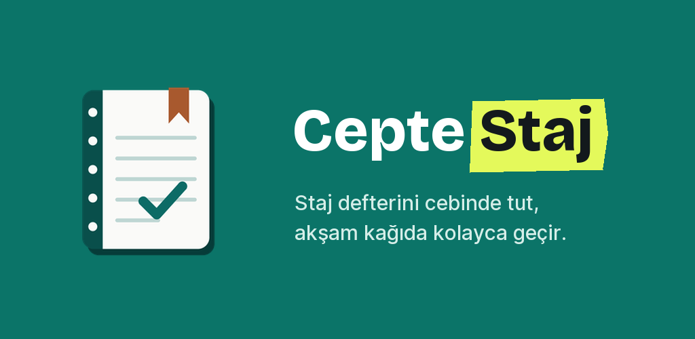
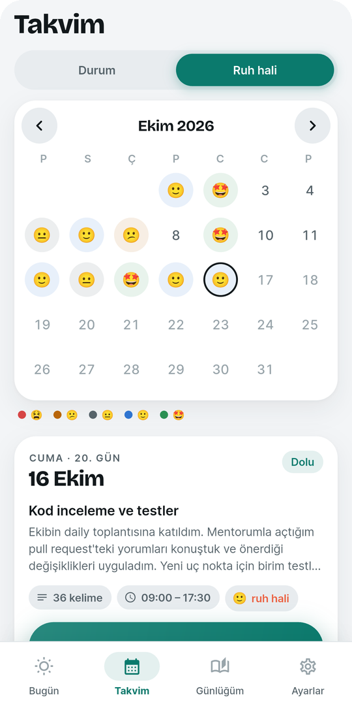
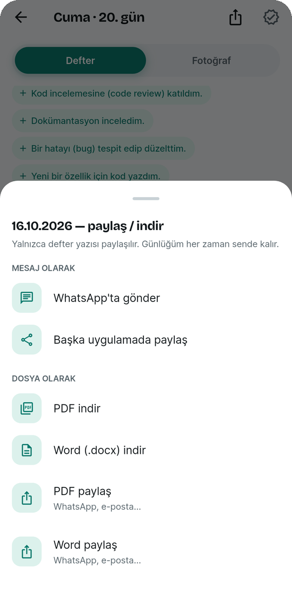

<p align="center">
  
</p>

<h1 align="center">Cepte Staj</h1>

<p align="center">
  Staj defteri tutan öğrenciler için: gün içinde hızlıca not al, defterini dakikalar
  içinde tamamla, stajını da hatırlanır bir deneyime dönüştür.<br>
  İngilizce telefonlarda adı <b>Intern Diary</b>.
</p>

<p align="center">
  
  
  
  
</p>

<p align="center">
  
  &nbsp;
  
  &nbsp;
  
</p>

Cepte Staj, **offline-first** bir Flutter uygulamasıdır. Hesap açmak gerekmez, sunucu ve
reklam yoktur; tüm veriler yalnızca telefonda saklanır.

## Uygulamanın iki katmanı

| | **Resmi Defter** | **Günlüğüm** (kişisel) |
|---|---|---|
| Ne için | Amire imzalatılacak, dışa aktarılan defter metni | Yalnızca senin için, stajın anısı |
| İçerik | Gün konusu, yapılan işler, giriş/çıkış saati, öğrendiklerin | Ruh hali, Günün Olayı, küçük zafer, şarkı, mentor sözleri, bingo, rozetler |
| Görünüm | Sade, teal vurgulu | Renkli, mercan vurgulu, el yazısı başlıklar |
| PDF / Word / WhatsApp'a girer mi | Evet | **Hayır, asla** |

Bu ayrım bir ayar değil, **mimari bir kural**. Dışa aktarma kodu (`lib/core/pdf_export.dart`,
`lib/core/official_export.dart`) yalnızca resmi alanları (`topic`, `body`, `learned`,
`checkIn`/`checkOut`) ve `includeInExport = true` işaretli fotoğrafları okur. Kişisel
alanlara hiçbir zaman erişmez ve bunu testler (`test/official_export_test.dart`,
`test/pdf_export_test.dart`) denetler.

## Ekranlar

### Bugün
Günün saatine göre karşılama, kalan iş günü halkası, ilerleme yüzdesi ve tahmini bitiş
tarihi. Altında bugünün defter durumu ve kelime hedefi, Günlüğüm'e kısa yol, seri / toplam
kelime / ruh hali / rozet kutuları, bu haftanın gün şeridi, tek dokunuşla açılan eksik günler,
son kayıtlar, tek dokunuşla artan hızlı sayaçlar (☕ kahve, 🐛 çözülen hata, 🙋 sorulan soru)
ve günün ipucu yer alır.

### Takvim
Aylık görünümde her günün durumu bir bakışta görülür: dolu, eksik, tatil, stajın başlangıç ve
bitiş günü. **Ruh hali** görünümü günleri o günkü ruh haline göre gösterir. Bir güne
dokununca altta özeti açılır, ikinci dokunuş günü açar. Resmi tatiller ve hafta sonları iş
günü sayımına otomatik olarak dahil edilmez.

<p align="center">
  
  &nbsp;
  
</p>

### Gün Detayı: Defter ve Fotoğraf
**Defter** sekmesinde günün konusu, staj alanına göre **hazır cümleler** (yazılım,
mühendislik, sağlık, eğitim, işletme, hukuk, tasarım, turizm…; kendi cümlelerin de
kaydedilebilir), dünden kopyala, giriş/çıkış saati ve öğrendiklerin bulunur. Alttaki sayaç
günlük kelime hedefini ve metnin kağıtta **kaç satır** tutacağını gösterir. Yazdıkların
otomatik kaydedilir. **Fotoğraf** sekmesinde galeriden ya da kameradan fotoğraf eklenir,
açıklama yazılır ve istenirse fotoğraf deftere dahil edilmek üzere işaretlenir.

Paylaş menüsünden gün **WhatsApp'ta** gönderilir, başka bir uygulamada paylaşılır ya da
**PDF / Word (.docx)** olarak indirilir. Her durumda yalnızca defter yazısı gider.

<p align="center">
  
  &nbsp;
  
</p>

### Günlüğüm (kişisel)
Doldurması iş gibi hissettirmeyen kişisel katman: 5'li ruh hali, sebep etiketleri ve
iş yoğunluğu, kategorili **Günün Olayı** (🤦 utanç · 😂 komik · 😱 panik · 💀 felaket ·
🏆 gurur · 🤔 tuhaf), günün küçük zaferi ve bugünün şarkısı (Spotify'dan "Paylaş → Cepte
Staj" ile doğrudan gelir). Aynı sekmede son 7 günün ruh hali grafiği, **Staj Bingo**,
rozetler, mentor sözlüğü ve **Zaman Kapsülü** de yer alır.

Rozetler: İlk Gün · 7 Gün Seri · Yarı Yol · 1000 Kelime · İlk Fotoğraf · Bingo Satırı ·
Hiç Gün Kaçırmadın · Gece Yazarı · Erken Kuş.

<p align="center">
  
  &nbsp;
  
</p>

### Staj Wrapped ve Ayarlar
**Staj Wrapped**, stajının Spotify Wrapped tarzında, kaydırmalı ve paylaşılabilir özetidir
(Ayarlar'dan açılır). Ayarlar'da staj tarihleri ve alanı, kelime hedefi, açık/koyu tema,
Türkçe/İngilizce dil, yazı boyutu, günlük hatırlatıcı, Günlüğüm PIN kilidi, tüm defterin
**PDF / Word** çıktısı ve yedekleme / geri yükleme bulunur.

<p align="center">
  
  &nbsp;
  
</p>

## Gizlilik

- Tüm veriler yalnızca cihazda saklanır, hiçbir sunucuya gönderilmez. Tek istisna:
  Spotify'dan bir şarkı paylaşıldığında, adını öğrenmek için yalnızca o şarkının bağlantısı
  Spotify'a sorulur (uygulamanın tek internet isteği, `lib/core/song_lookup.dart`).
- Günlüğüm, PDF / Word / WhatsApp çıktılarına asla girmez.
- Günlüğüm isteğe bağlı bir **PIN** ile kilitlenir. Kilitliyken ruh hali Bugün ve Takvim
  ekranlarında da gizlenir, Staj Wrapped de PIN ister. Uygulama 30 saniyeden uzun arka
  planda kalırsa kilit kendiliğinden yeniden devreye girer.
- Ayrıntılar: [Gizlilik Politikası](docs/PRIVACY_POLICY.md).

## Mimari

- **State yönetimi:** `provider` ile tek bir `ChangeNotifier` (`lib/data/app_state.dart`);
  tüm ekranlar bu tek kaynağı okur ve yazar.
- **Kalıcılık:** Backend ve veritabanı yok. `lib/core/local_store.dart` tüm uygulama durumunu
  tek bir JSON olarak `shared_preferences` içine yazar. Yazma işlemleri kısa bir gecikmeyle
  toplanır; uygulama arka plana alındığında bekleyen değişiklikler hemen diske yazılır.
  Fotoğraflar uygulamanın kendi klasörüne kopyalanır (`lib/core/photo_service.dart`).
- **Veri modelleri:** `lib/models/models.dart` içinde `Internship`, `DayEntry` (resmi ve
  kişisel alanlar aynı kayıtta ama ayrı kullanımda), `DayPhoto`, `QuickCounter`,
  `MentorQuote`, `BingoTask`, `AppBadge`.
- **İş günü hesaplayıcı:** `lib/core/workday_calculator.dart`, Türkiye resmi tatillerini
  (`lib/core/holidays.dart`) ve seçilen çalışma günlerini hesaba katarak kalan/geçmiş iş
  günlerini ve tahmini bitiş tarihini hesaplar. Birim testlidir.
- **Rozet motoru:** `lib/core/achievements.dart`, her kayıttan sonra çalışan saf (yan
  etkisiz) bir fonksiyondur.
- **Dışa aktarma:** `lib/core/pdf_export.dart` Türkçe karakter destekli "Resmi Defter"
  PDF'ini, `lib/core/official_export.dart` Word (.docx) ve düz metin sürümünü üretir;
  ikisi de `share_plus` ile paylaşılır ya da İndirilenler'e kaydedilir.
- **Yedekleme:** `lib/core/backup_service.dart`, kişisel katman ve fotoğraflar dahil tüm
  durumu bir `.zip` dosyasına (`data.json` + `photos/`) aktarır ve geri yükler. Bu,
  dışa aktarmadan farklı olarak yalnızca kullanıcının kendisi içindir.
- **Bildirimler:** `lib/core/notification_service.dart`, `flutter_local_notifications` ve
  `timezone` ile günlük hatırlatmayı zamanlar.
- **PIN kilidi:** `lib/core/pin.dart`, PIN'i tuzlanmış SHA-256 özeti olarak saklar.
- **Dil:** `lib/core/i18n.dart` + `lib/core/i18n_en.dart`; her `t('…')` metninin İngilizce
  karşılığı olduğunu `test/i18n_test.dart` denetler. Android'deki uygulama adı
  `res/values/strings.xml` (Cepte Staj) ve `res/values-en/strings.xml` (Intern Diary) ile
  telefon diline göre değişir.

Renk, yazı ve boşluk token'ları `lib/theme/` altındadır. Resmi defter tarafının vurgu rengi
teal (`#0B7A6D`), kişisel Günlüğüm tarafınınki mercandır (`#EC5F3F`); tek "yüksek sesli" renk
fosforlu kalem sarısıdır (`#E4F95B`). Yazı tipleri: başlıklarda Bricolage Grotesque, metinde
Inter, Günlüğüm başlıklarında el yazısı Caveat. Açık ve koyu tema desteklenir.

## Geliştirme

Standart bir Flutter projesidir (Android öncelikli).

```bash
flutter pub get
flutter run                        # bağlı cihazda çalıştır
flutter test                       # birim + widget testleri
flutter analyze                    # statik analiz
flutter build apk --release        # APK: build/app/outputs/flutter-apk/
flutter build appbundle --release  # Play Store paketi (.aab)
```

Play Store'a yükleme adımları, mağaza metinleri ve görseller:
[`docs/PLAY_STORE.md`](docs/PLAY_STORE.md) ve [`docs/play-store/`](docs/play-store/).

**Klasör yapısı**

```
lib/
  main.dart              uygulama girişi, tema ve Provider kurulumu
  core/                  iş günü hesabı, tatiller, rozetler, PDF/Word, yedek, bildirim, PIN, dil
  data/app_state.dart    uygulamanın tüm durumu (tek ChangeNotifier)
  models/models.dart     veri modelleri (JSON serileştirme dahil)
  features/onboarding/   onboarding akışı
  screens/               bugün, takvim, gün detayı, günlüğüm, wrapped, ayarlar, kilit
  theme/                 renk, yazı ve boşluk token'ları
  widgets/               ortak bileşenler
test/                    iş günü hesabı, dışa aktarma, yedek, PIN kilidi, dil ve widget testleri
docs/
  PLAY_STORE.md          yayınlama rehberi
  PRIVACY_POLICY.md      gizlilik politikası
  play-store/            simge, öne çıkan grafik, mağaza ekran görüntüleri ve metinleri
  screenshots/           README görselleri
```

> Ekran görüntüleri örnek (demo) staj verisiyle, gerçek bir Android telefonda alınmıştır.
